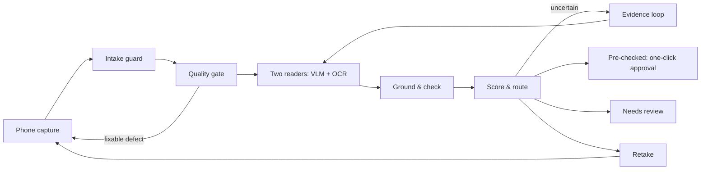

# Qareena · قرينة

**A local-first KYC document agent for merchant onboarding.** Built for the ZainCash Agentic AI Challenge Iraq, Topic 05 (KYC Document Agent).

Qareena reads phone photos of a merchant's national ID, business license and tax card. It extracts every field with its source region, checks the fields against a written rulebook and against each other, and attaches a calibrated confidence to each field. The result is one of three outcomes:

| Outcome | Arabic | What happens |
|---|---|---|
| ✓ Pre-checked | جاهز للموافقة | Every critical field is confirmed by two sources. The reviewer approves in one click |
| ! Needs review | يحتاج مراجعة | Only the fields that need a decision, each with its crop, score and reason |
| ↻ Retake | إعادة تصوير | Specific guidance to the applicant in Iraqi Arabic. The file resumes when the new photo arrives |

Each field also carries a calibrated score and an action band: مطابق (matches), تأكد (check) or راجع (decide).

A person signs off every file. Qareena never fills in a field it couldn't read, and it never follows text written inside a document. "Pre-checked" never means "identity verified": face matching, liveness and forgery detection are out of scope.

> **Status (22 Oct 2026): building.** The pipeline runs end to end on fictional packets (quality gate → two readers → label-anchored grounding → rules → scoring → routing), and the dataset builder and evaluation harness exist. Spike results are in [`docs/spike/`](docs/spike/). **No test-set results are claimed yet:** Test-A opens at the MVP (6 Nov).

## Documents

- **Design brief (5 slides):** [`docs/design-brief/MomenSaeb_KYCDocumentAgent.pdf`](docs/design-brief/MomenSaeb_KYCDocumentAgent.pdf)
- **Technical design:** [`docs/DESIGN.md`](docs/DESIGN.md). Covers architecture, the evidence loop, calibration, rules, the evaluation protocol, security, the failure-mode catalogue, unexpected inputs, production and the demo.
- **Decision log:** [`docs/DECISIONS.md`](docs/DECISIONS.md). Records why each major choice was made, and what would change it.
- **Observed failure modes:** [`docs/FAILURE_MODES.md`](docs/FAILURE_MODES.md). What went wrong in our own runs, what the system now does about it, and what risk remains.
- **Disclosure:** [`docs/DISCLOSURE.md`](docs/DISCLOSURE.md). Lists every model, tool, data source and AI assistant used.
- **Research and sources:** [`docs/RESEARCH.md`](docs/RESEARCH.md)

## Architecture at a glance



Everything in the live path runs on one machine. Document images and PII do not leave it.

## Run it

Requirements: Windows or Linux, Python 3.12, [uv](https://docs.astral.sh/uv/), [Ollama](https://ollama.com) ≥ 0.40 with `qwen3.5:4b`, and Microsoft Edge (used headless to render the fictional documents).

```bash
uv sync --group synth                      # dependencies (synth: templates + renderer)
ollama pull qwen3.5:4b
uv run qareena status                      # configuration fingerprint, certificate, model server

# one fictional packet, then read it
uv run qareena synth-packet --scenario grandfather_conflict --layout a --out var/packets/P1
uv run qareena run var/packets/P1

# evaluation: build a split, run it, fit the scorer (dev), certify thresholds (calib), report
uv run qareena build-dataset --split dev
uv run qareena eval run --split dev
uv run qareena eval fit --split dev
uv run qareena eval report --split dev
```

Images, traces and certificates go to `var/` (git-ignored). The seals of the test splits go to `docs/data/seals/` and are committed.

## Ground rules this repo follows

- **Synthetic data only.** All documents are fictional, rendered from our own SPECIMEN templates. No real documents are ever used.
- **No secrets in git.** Configuration goes in `.env` (see `.env.example`). CI runs a gitleaks secret scan on every push.
- **Two held-out test sets are sealed by hash** when they are created. Test-A is opened at the MVP; Test-B is opened once, at the progress review.
