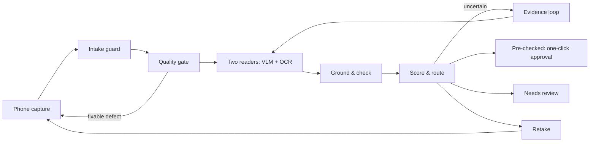

# Qareena · قرينة

**A local-first KYC document agent for merchant onboarding.** Built for the ZainCash Agentic AI Challenge Iraq, Topic 05 (KYC Document Agent).

Qareena reads phone photos of a merchant's national ID, business license and tax card. It extracts every field with its source region, checks the fields against a written rulebook and against each other, and attaches a calibrated confidence to each field. The result is one of three outcomes:

| Outcome | Arabic | What happens |
|---|---|---|
| ✓ Pre-checked | مطابق | Every critical field is confirmed by two sources. The reviewer approves in one click |
| ! Needs review | راجع / تأكد | Only the fields that need a decision, each with its crop, score and reason |
| ↻ Retake | إعادة تصوير | Specific guidance to the applicant in Iraqi Arabic. The file resumes when the new photo arrives |

A person signs off every file. Qareena never fills in a field it couldn't read, and it never follows text written inside a document. "Pre-checked" never means "identity verified": face matching, liveness and forgery detection are out of scope.

> **Status (22 Oct 2026): design stage.** The design brief is submitted, and the build starts on 23 Oct. No results are claimed yet.

## Documents

- **Design brief (5 slides):** [`docs/design-brief/MomenSaeb_KYCDocumentAgent.pdf`](docs/design-brief/MomenSaeb_KYCDocumentAgent.pdf)
- **Technical design:** [`docs/DESIGN.md`](docs/DESIGN.md). Covers architecture, the evidence loop, calibration, rules, the evaluation protocol, security, the failure-mode catalogue, unexpected inputs, production and the demo.
- **Decision log:** [`docs/DECISIONS.md`](docs/DECISIONS.md). Records why each major choice was made, and what would change it.
- **Disclosure:** [`docs/DISCLOSURE.md`](docs/DISCLOSURE.md). Lists every model, tool, data source and AI assistant used.
- **Research and sources:** [`docs/RESEARCH.md`](docs/RESEARCH.md)

## Architecture at a glance

Everything in the live path runs on one machine. Document images and PII do not leave it.

## Ground rules this repo follows

- **Synthetic data only.** All documents are fictional, rendered from our own SPECIMEN templates. No real documents are ever used.
- **No secrets in git.** Configuration goes in `.env` (see `.env.example`), and CI runs a secret scan.
- **Two held-out test sets are sealed by hash** when they are created. Test-A is opened at the MVP; Test-B is opened once, at the progress review.
